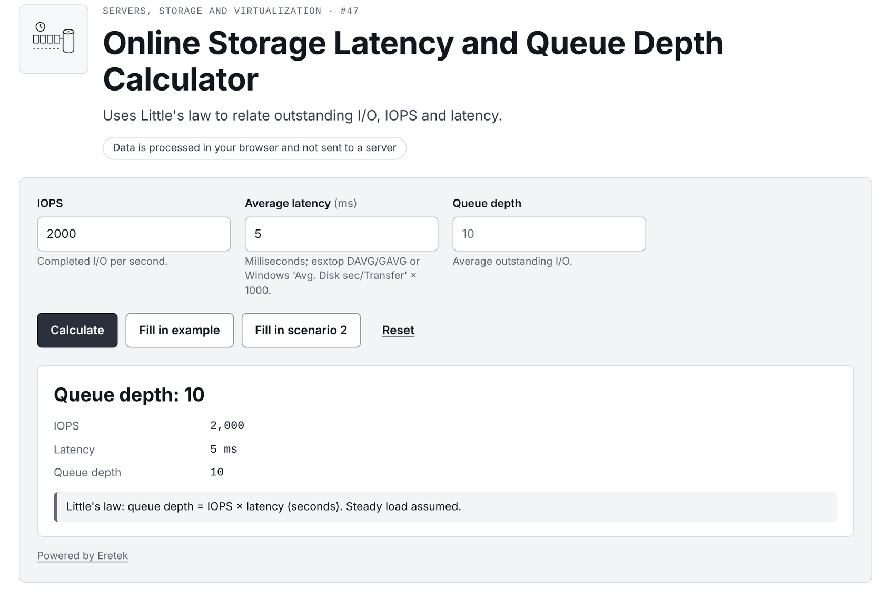

# Storage Latency and Queue Depth Calculator

Enter two of IOPS, average latency (ms) and queue depth and find the third with Little's law; interpret storage performance problems.

## Try it live

- [Türkçe](https://sistem.eretek.com/araclar/depolama-gecikme-kuyruk-derinligi)
- [English](https://sistem.eretek.com/en/tools/storage-latency-queue-depth)
- [Deutsch](https://sistem.eretek.com/de/werkzeuge/latenz-queue-depth-rechner)



## What it does

Uses Little's law to relate outstanding I/O, IOPS and latency.

When a VM is 'slow', the storage view shows high latency, but latency is directly linked to the number of concurrent I/Os (queue depth). Little's law (L = λ × W) lets you derive any one of the three from the other two and shows whether measurements are consistent.

## Where it helps

Latency above 20 ms with a high queue means storage is saturated; low queue with high latency points to the path (HBA, network, controller).

## How to use it

1. Enter two of IOPS, average latency (ms) and average queue depth.
2. Press Calculate.

### Fields

| Field | Description |
|---|---|
| IOPS | Completed I/O per second. |
| Average latency | Milliseconds; esxtop DAVG/GAVG or Windows 'Avg. Disk sec/Transfer' × 1000. |
| Queue depth | Average outstanding I/O. |

## Example input

Press **Fill in example** in the tool to load this input.

| Input | Value |
|---|---|
| IOPS | `2000` |
| Average latency | `5` |

**Expected result:** 2,000 IOPS × 5 ms = on average 10 outstanding I/Os.

## Method and assumptions

Queue depth = IOPS × latency (s). Steady state is assumed; with three values a deviation above 2 % is reported as an error.

## Limits and common mistakes

- Works with averages; bursts and percentile (p99) latencies are not visible.

## Run it locally

The tool is plain HTML, CSS and JavaScript with no build step and no dependencies.

```bash
git clone https://github.com/eretek/storage-latency-queue-depth.git
cd storage-latency-queue-depth
node scripts/serve.js        # or: python3 -m http.server 8080
```

Open <http://127.0.0.1:8080/>. Add `?lang=tr` or `?lang=de` for Turkish or German; without it the page follows the browser language and falls back to English. You can also open `index.html` directly from disk.

Run the tests (Node.js 18 or later):

```bash
node test/run.js    # or: npm test
```

The tests run the tool's own fixtures and the worked examples in all three languages without a browser.

## How it works

All processing happens in your browser. The tool makes no network requests, uses no cookies or browser storage, and does not upload files you select.

No server-side component is needed. The version on the Eretek website renders the same page through a private WordPress plugin; that plugin only produces the page markup and is not part of this repository.

| Path | Purpose |
|---|---|
| `index.html` | Page shell |
| `src/app.js` | Builds the page in Turkish, English or German from `src/data.js` |
| `src/data.js` | Field definitions, examples and all texts in three languages |
| `src/core.js` | Shared runtime: validation, number formats, result rendering, CSV/ICS export |
| `src/tool.js` | The calculation or analysis for this tool |
| `docs/screenshot.png` | Screenshot used in this README |
| `src/tools.css`, `src/page.css` | Styles |
| `test/run.js`, `test/cases.json` | Headless tests |

## License and attribution

This tool is released under the [Eretek Website Attribution License](LICENSE). You may use, modify and redistribute it, including commercially. If you make it available on a website or web application, show a visible, clickable credit linking to https://eretek.com/ on every page where the tool is available, for example:

```html
<a href="https://eretek.com/">Powered by Eretek</a>
```

You may add `rel="nofollow"` to the link. Keep the copyright notice and license text in copies and redistributions.
